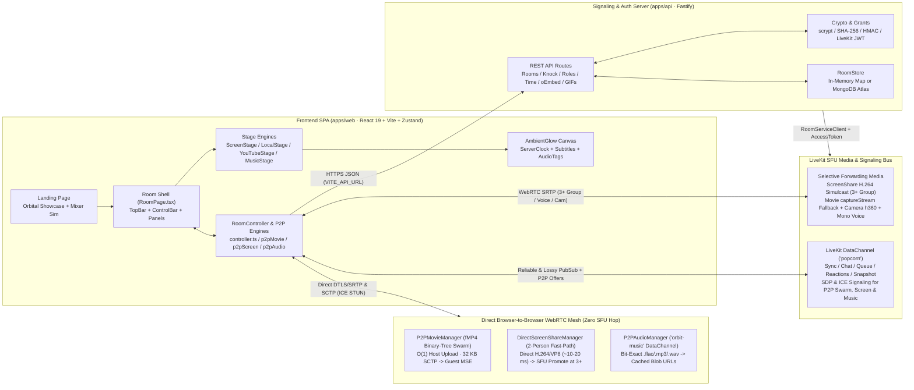
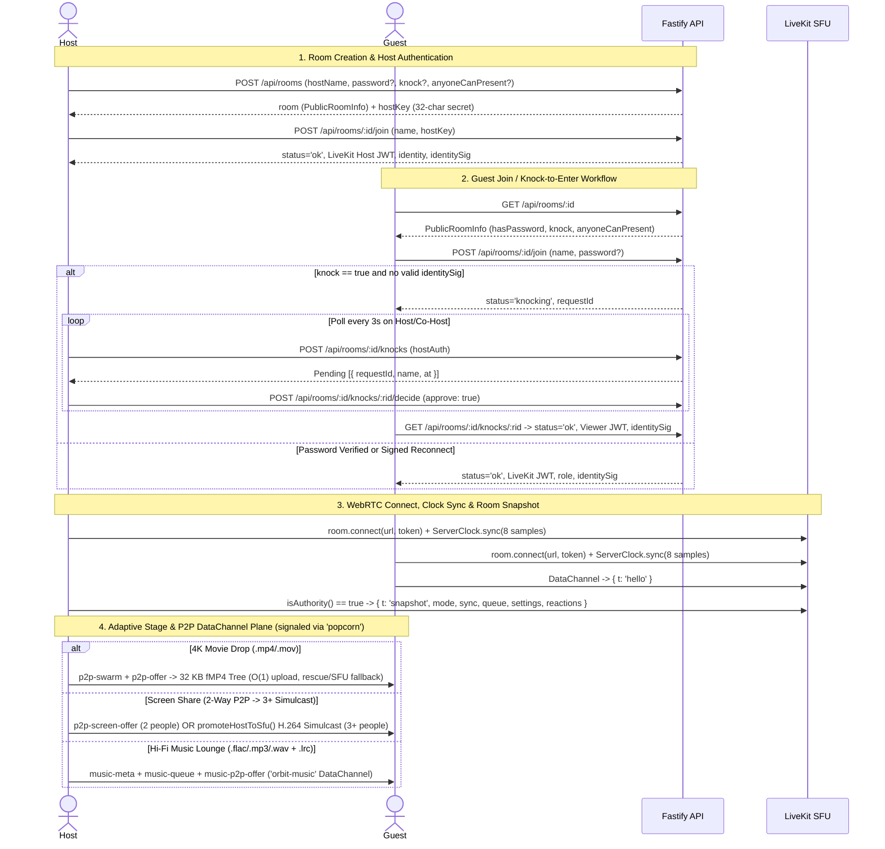
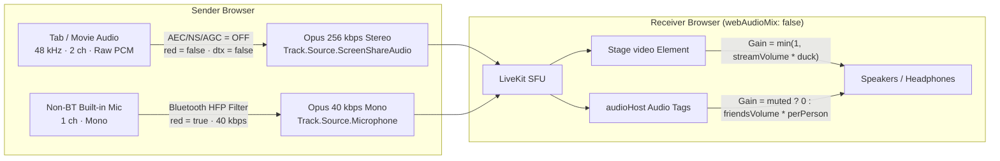
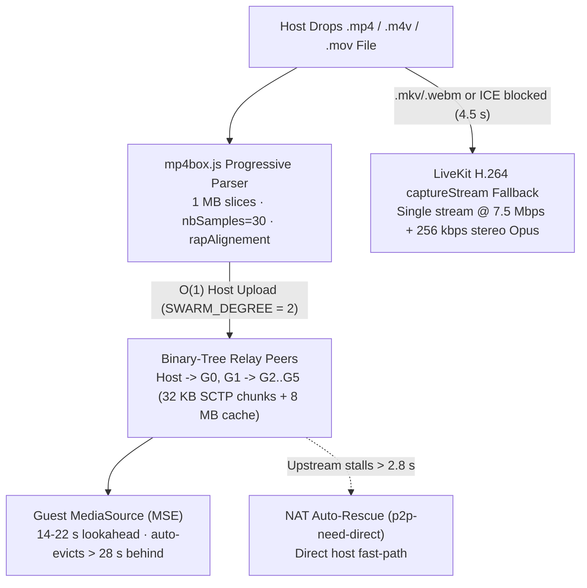
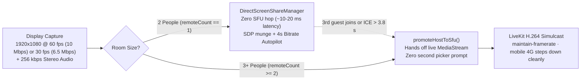
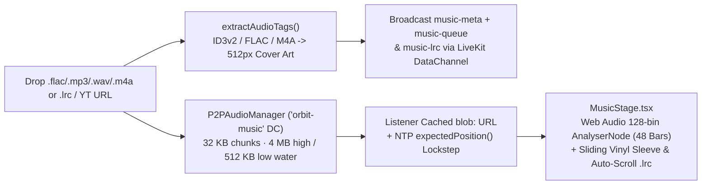
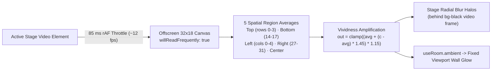
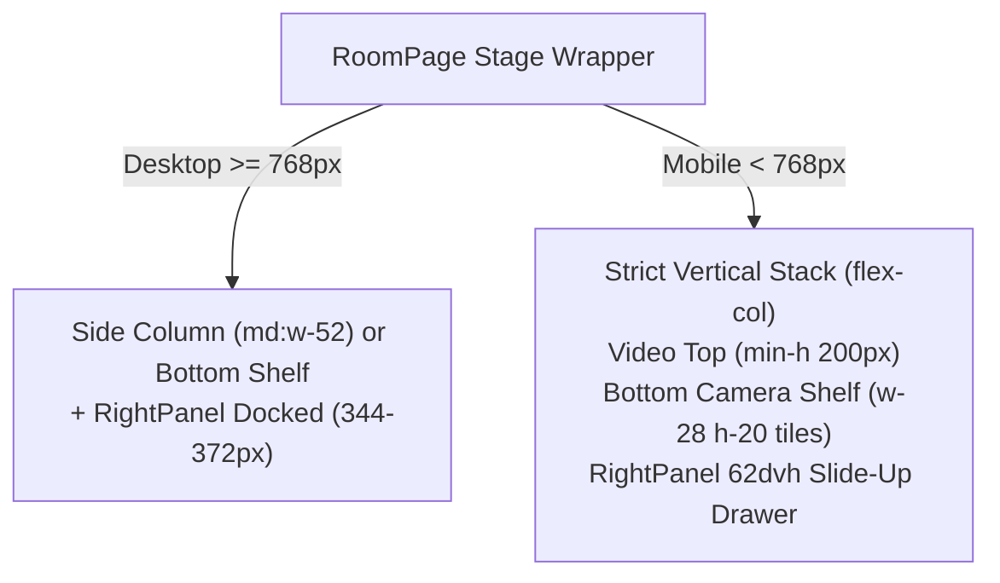

<div align="center">

# 🪐 The Orbit (`@popcorn/*`)

### **One screen at the center. Everyone in orbit.**

A 100% free, zero-account, cinema-grade real-time watch-party & music-lounge platform with **Binary-Tree P2P Swarm 4K Movie Delivery**, **2-Person Direct P2P / 3+ H.264 Simulcast 60 fps Screen Share**, **Lossless P2P Music Lounge with `.lrc` Lyrics**, **NTP-Synced YouTube Lockstep**, **Real-Time 4-Zone Canvas Ambilight**, and **Studio-Isolated Voice & Camera Chat** across laptop and mobile browsers.

[](#13-local-development-testing--free-tier-deployment)
[](#5-monorepo-workspace--complete-file-inventory)
[](#3-system-architecture--network-topology)
[](#13-local-development-testing--free-tier-deployment)

</div>

---

## Table of Contents

1. [Core Agenda & Design Philosophy](#1-core-agenda--design-philosophy)
2. [How The Orbit Differs from Other Platforms](#2-how-the-orbit-differs-from-other-platforms)
3. [System Architecture & Network Topology](#3-system-architecture--network-topology)
4. [Connection, Auth, Knock-to-Enter & Authority Sync Flow](#4-connection-auth-knock-to-enter--authority-sync-flow)
5. [Monorepo Workspace & Complete File Inventory](#5-monorepo-workspace--complete-file-inventory)
6. [Audio & Video Systems Engineering (Deep Dive)](#6-audio--video-systems-engineering-deep-dive)
   - [6.1 Dual-Track Audio Isolation, RED Prevention & Bluetooth HFP Guard](#61-dual-track-audio-isolation-red-prevention--bluetooth-hfp-guard)
   - [6.2 Unified Single-Element Hardware A/V Lip-Sync & Playout Lock](#62-unified-single-element-hardware-av-lip-sync--playout-lock)
   - [6.3 Hybrid 4K Local Movie Drop, Binary-Tree P2P Swarm & Live WebRTC Fallback](#63-hybrid-4k-local-movie-drop-binary-tree-p2p-swarm--live-webrtc-fallback)
   - [6.4 Adaptive 60 fps Screen Share: 2-Way Direct P2P, 3+ H.264 Simulcast & Bitrate Autopilot](#64-adaptive-60-fps-screen-share-2-way-direct-p2p-3-h264-simulcast--bitrate-autopilot)
   - [6.5 Client-Side Subtitle Engine (`.srt` → WebVTT + Dynamic Shifter)](#65-client-side-subtitle-engine-srt--webvtt--dynamic-shifter)
   - [6.6 Hi-Fi Listen Together Music Lounge, P2P Audio & Synced `.lrc` Lyrics](#66-hi-fi-listen-together-music-lounge-p2p-audio--synced-lrc-lyrics)
7. [Time Synchronization & YouTube Lockstep Algorithms](#7-time-synchronization--youtube-lockstep-algorithms)
   - [7.1 NTP Minimum-RTT Clock Offset Estimation (`ServerClock`)](#71-ntp-minimum-rtt-clock-offset-estimation-serverclock)
   - [7.2 YouTube Timeline Math, Drift Decision Matrix & Autoplay Recovery](#72-youtube-timeline-math-drift-decision-matrix--autoplay-recovery)
8. [Visual Immersion, Camera Engineering & Responsive UI](#8-visual-immersion-camera-engineering--responsive-ui)
   - [8.1 Dynamic 4-Zone Canvas Ambilight Engine (`AmbientGlow`)](#81-dynamic-4-zone-canvas-ambilight-engine-ambientglow)
   - [8.2 Six Non-Pink Cinema Themes (`[data-theme]` Palette Spec)](#82-six-non-pink-cinema-themes-data-theme-palette-spec)
   - [8.3 Camera Hardware Lifecycle, Orientation Parity & Mobile Layout](#83-camera-hardware-lifecycle-orientation-parity--mobile-layout)
   - [8.4 Landing Experience, Chat, Queue, Recap Heatmap & Keyboard Shortcuts](#84-landing-experience-chat-queue-recap-heatmap--keyboard-shortcuts)
9. [State Management Architecture (`useRoom` & `localStorage`)](#9-state-management-architecture-useroom--localstorage)
10. [Security Model, Cryptography, Roles & Rate Limiting](#10-security-model-cryptography-roles--rate-limiting)
11. [Complete REST API & LiveKit DataChannel Reference](#11-complete-rest-api--livekit-datachannel-reference)
12. [Hard-Won Engineering Fixes & Production Postmortems](#12-hard-won-engineering-fixes--production-postmortems)
13. [Local Development, Testing & Free-Tier Deployment](#13-local-development-testing--free-tier-deployment)

---

## 1. Core Agenda & Design Philosophy

Most watch-party and conferencing tools either compress audio like a phone call, require browser extensions/paid accounts, or break down when desktop and phone users watch together.

**The Orbit** is designed from first principles around four pillars:

> [!IMPORTANT]
> **The Unshakeable Sound Rule:** Movie and tab audio must travel as untouched **48 kHz stereo (256 kbps Opus)** with voice DSP strictly turned **OFF**, while participant voices travel on a separate channel and are mixed strictly locally on each viewer's device.

1. **Zero Friction Entry:** No accounts, logins, extensions, or downloads. Create a room in one click and share `/r/:roomId`.
2. **Four Stage Modes Under One Roof:** Seamlessly switch between **60 fps Screen Share**, **Synced YouTube**, **4K Local Movie Drop**, and **Hi-Fi Music Lounge** inside the same live session.
3. **Desktop & Phone Parity:** Adaptive layouts automatically move camera strips and chat drawers to non-overlapping bottom surfaces on phones while preserving desktop theatre columns.
4. **100% Free Infrastructure:** Zero paid SaaS dependencies—runs cleanly on free tiers (**Vercel** + **Render** + **LiveKit Cloud Free Tier** or self-hosted **Oracle Cloud Docker** + optional **MongoDB Atlas M0** & **GIPHY**).

---

## 2. How The Orbit Differs from Every Other Watch-Party App

| Feature / Engineering Layer | Teleparty / Extensions | Discord / Meet Screen Share | Virtual Browser Services | **The Orbit** |
| :--- | :--- | :--- | :--- | :--- |
| **Account & Install** | Extension + streaming login required | Account + desktop client for system audio | Account + wait queues | **Pure web URL, instant anonymous guest entry** |
| **Movie vs. Voice Audio** | Relies on external voice chat | Voice AEC/AGC often pumps music; Nitro needed for high quality | Encoded into single VM stream | **Independent stereo movie track (`red: false`) + mono voice track (`40 kbps`)** |
| **Bluetooth Headset Bug** | Unhandled by website | Opening headset mic forces OS 8 kHz HFP telephony mode | Unhandled | **Auto-excludes Bluetooth HFP mics, re-asserts stereo constraints & frees hardware on mute** |
| **A/V Lip-Sync** | Separate from voice overlay | Video & audio jitter buffers can drift apart | Single VM container | **Unified single `<video>` element + locked `120 ms` playout delay on both tracks** |
| **Screen Share Routing** | Server relay | Always routes 2-person shares via SFU | Cloud VM relay | **2-person Direct P2P fast-path (~10–20 ms) + seamless 3+ H.264 Simulcast promotion & bitrate autopilot** |
| **Local Movie Files** | Not supported | OS window capture only | Requires uploading full file | **Binary-Tree P2P Swarm (`O(1)` host upload, `mp4box.js` fMP4 + MSE) + live H.264 WebRTC fallback** |
| **Listen Together Music** | Not supported | Compressed voice-bot audio | Requires paid bots | **Bit-exact `.flac`/`.mp3`/`.wav` P2P DataChannel transfer, cover art parser, spectrum bars & `.lrc` lyrics** |
| **Custom Subtitles** | Locked to platform captions | None | None | **Offline `.srt` → WebVTT parser + real-time `±0.5 s` offset shifter + 4 font scales** |
| **Theater Immersion** | None | Static dark theme | Plain iframe | **Real-time `32×18` edge-sampling 4-zone Ambilight + 6 non-pink cinema themes** |

---

## 3. System Architecture & Network Topology

**The Orbit** splits responsibilities cleanly across three layers so the API server never touches heavy video/audio traffic and browsers handle rendering, subtitle parsing, and local mixing natively:



### Design Responsibility Split

| Layer | What It Handles | What It Deliberately Avoids |
| :--- | :--- | :--- |
| **`apps/web`** | WebRTC track & P2P DataChannel engines (`p2pMovie`, `p2pScreen`, `p2pAudio`, `bitrate`), NTP probing, YouTube IFrame API, `.srt`/ID3/`.lrc` parsing, `32×18` Ambilight | Exposing GIPHY API keys, trusting client role claims without server JWTs |
| **`apps/api`** | Room creation, salted password verification, waiting-room knocks, signed identity HMACs, LiveKit JWT minting, oEmbed caching, GIPHY proxy | Touching any media bytes, transcoding video/audio, running heavy room timers |
| **`LiveKit SFU`** | Forwarding camera/voice + 3+ H.264 Simulcast screen shares & `.mkv` fallbacks, enforcing `canPublishSources` & `canUpdateOwnMetadata: false`, relaying `DATA_TOPIC` signaling | Persistent storage or server-side media recording |
| **Direct P2P Mesh** | Offloading 4K fMP4 movie swarms (`O(1)` host upload), 2-person ultra-low-latency screen shares (`~10–20 ms`), and lossless Music Lounge audio transfers between peers | Routing through external SFU bandwidth caps when direct STUN/ICE succeeds |

---

## 4. Connection, Auth, Knock-to-Enter & Authority Sync Flow

Every session enforces server-signed role permissions, optional waiting-room admission, minimum-RTT clock alignment, and seamless state catch-up for latecomers or refreshing tabs:



### Deterministic Authority Election (`controller.isAuthority()`)
Instead of maintaining stateful WebSocket room timers on the backend, peers elect one connected authority dynamically:
- Rank weights: `host = 2`, `cohost = 1`, `viewer = 0`.
- Sorted by highest `roleRank` → earliest LiveKit `joinedAt` timestamp → alphabetical `identity`.
- That elected authority responds to `hello` with full room `snapshot` state and coordinates `autoPauseOnBuffer` if any viewer stalls.

---

## 5. Monorepo Workspace & Complete File Inventory

```text
Popcorn Room/
├── package.json                  # npm workspaces root ("apps/*", "packages/*") & scripts
├── packages/
│   └── shared/                   # @popcorn/shared — pure TypeScript types, crypto-free helpers & algorithms
│       └── src/
│           ├── index.ts          # Role, ParticipantMeta, PublicRoomInfo, LIMITS, hueFromString, parseMeta
│           ├── messages.ts       # StageMode ('music' incl.), RoomTheme, MusicTrackItem, P2P & Sync DataMessages
│           ├── sync.ts           # SyncState, DRIFT, expectedPosition, msUntilStart, decideDrift, computeOffset
│           ├── youtube.ts        # parseYouTubeId, parseYouTubeStart, ytThumb
│           └── sync.test.ts      # 18 Vitest unit tests
├── apps/
│   ├── api/                      # @popcorn/api — Fastify REST & LiveKit token/moderation backend
│   │   ├── .env.example          # Port, CORS, LiveKit, Identity Secret, MongoDB & GIPHY templates
│   │   └── src/
│   │       ├── config.ts         # Production env assertions, CORS list parsing, WSS->HTTPS host derivation
│   │       ├── livekit.ts        # AccessToken builder, permission enforcement, muteMic, applyToAll
│   │       ├── server.ts         # 15 HTTP routes, rate limiters, 10-min knock reaper, YouTube oEmbed cache
│   │       └── store.ts          # MemoryStore, MongoStore, scryptSync passwords, SHA-256 & HMAC helpers
│   └── web/                      # @popcorn/web — React 19 + Vite + Tailwind CSS v4 + Motion + LiveKit Client
│       ├── index.html            # Mobile viewport meta, theme color #090d16, Plus Jakarta Sans & Inter fonts
│       ├── public/favicon.svg    # Vector Orbit planet & ring emblem
│       ├── vercel.json           # SPA fallback rewrite -> /index.html
│       └── src/
│           ├── index.css         # Tailwind tokens, orbital keyframes, 6 [data-theme] skins, .butter-btn
│           ├── main.tsx          # React Router & Sonner toast provider bootstrap
│           ├── pages/
│           │   ├── Landing.tsx   # Orbital hero showcase, UpgradesShowcase cards, Mixer simulator, CreateRoom
│           │   └── RoomPage.tsx  # Stage container, global file drop overlay, wall Ambilight, Dark Join gate
│           ├── room/
│           │   └── controller.ts # RoomController singleton managing WebRTC, media tracks, mixing & data bus
│   │           │   ├── p2pMovie.ts   # Binary-tree P2P Swarm fMP4 streamer (mp4box.js + MSE lookahead & eviction)
│   │           │   ├── p2pScreen.ts  # 2-person Direct P2P screen share fast-path + SFU Simulcast promoter
│   │           │   ├── p2pAudio.ts   # Bit-exact .flac/.mp3/.wav WebRTC DataChannel audio distributor
│   │           │   └── bitrate.ts    # SDP x-google bitrate munger + 4s sender BWE/loss autopilot
│           ├── store/
│           │   └── room.ts       # Zustand useRoom state store + localStorage audio/UI defaults
│           ├── lib/
│           │   ├── api.ts        # Fetch client with VITE_API_URL & 2 MB speedtest probe
│   │           │   ├── audioTags.ts  # Zero-dep ID3v2 / FLAC / M4A metadata + cover extractor & .lrc parser
│           │   ├── browser.ts    # Browser/OS matrix & screen-audio capability flags (caps)
│           │   ├── clock.ts      # ServerClock NTP poller
│           │   ├── fullscreen.ts # Cross-browser fullscreen helpers
│           │   ├── session.ts    # Per-room secrets & user prefs in localStorage
│           │   ├── subtitles.ts  # Offline .srt -> WEBVTT parser & cue time-shifter
│           │   └── utils.ts      # cn(), uid(), initials(), timeOfDay(), isTypingTarget()
│           └── components/       # UI modules: ScreenStage, LocalStage, YouTubeStage, MusicStage, HUD, chat, mixer
├── infra/
│   ├── DEPLOYMENT.md             # Free-tier deploy instructions
│   ├── Dockerfile.api            # Production Node API Docker build
│   ├── docker-compose.yml        # Self-hosted LiveKit SFU + Redis + API
│   └── livekit.yaml              # Self-hosted LiveKit port & dev credentials
└── tests/
    ├── playwright.config.ts      # Chromium test runner with fake media devices & dual local webServers
    └── room.spec.ts              # End-to-end tests for The Orbit Landing & 2-user Watch Party join
```

---

## 6. Audio & Video Systems Engineering (Deep Dive)

### 6.1 Dual-Track Audio Isolation, RED Prevention & Bluetooth HFP Guard



1. **Opus `red: false` Fix for Stereo Music:** Inspecting `LocalParticipant.mjs` inside `livekit-client` confirmed that enabling RFC 2198 redundancy (`red: true`) on a `forceStereo: true` track conflicts with stereo Opus music encoding, causing distortion and cutouts. Both `ScreenShareAudio` and `local-movie-audio` explicitly override `publishDefaults` with **`red: false`**, **`dtx: false`**, and **`forceStereo: true`**.
2. **Bluetooth Hands-Free (HFP) Auto-Protection (`controller.toggleMic` & `MixerPopover`):**
   - `MixerPopover` intentionally avoids calling `getUserMedia({ audio: true })` on mount so opening settings never activates headset mics prematurely.
   - When `toggleMic()` turns ON, it enumerates devices and filters out `/headset|bluetooth|buds|airpods|hands-free|handsfree|hfp|sco|ag audio|telephony/i` or `communications`, selecting internal array/wired microphones first.
   - Immediately after opening the mic, it calls `.applyConstraints({ echoCancellation: false, noiseSuppression: false, autoGainControl: false, channelCount: 2, sampleRate: 48000 })` on any active `ScreenShareAudio` track so WebRTC never applies voice DSP to the movie.
   - Turning the mic OFF calls `mediaStreamTrack.stop()` + `lp.unpublishTrack(pub.track, true)`, instantly releasing Windows/phone Bluetooth HFP locks back to hi-fi A2DP stereo.
3. **Zero-Output Local Speech Detector (`startLocalAudioMonitor`):** Polls a 128-bin `AnalyserNode` (created with `sinkId: { type: 'none' }` where supported) every `60 ms`, triggering `localSpeaking` above `0.012` average bin magnitude with a `4`-frame (`240 ms`) trailing release.
4. **Smooth Smart Ducking (`controller.updateDuck`):** Off by default (`smartDuck: false`). When enabled and a remote speaker is active, smoothly steps `duck` between `1.0` and `0.7` (`-3 dB`) every `40 ms` (`0.06` fast attack / `0.03` gentle release).

---

### 6.2 Unified Single-Element Hardware A/V Lip-Sync & Playout Lock

- **Shared `<video>` Clock:** `controller.attachAudio()` mounts **only** `Track.Source.Microphone` inside `#audioHost`. Both `ScreenStage.tsx` and `LocalStage.tsx` attach **both** `Track.Source.ScreenShare` (video) and `Track.Source.ScreenShareAudio` (audio) directly onto the same DOM `<video>` element, placing both tracks under one browser media timeline and preventing separate jitter-buffer drift.
- **Playout Delay Matching (`TrackSubscribed`):** For both `ScreenShare` and `ScreenShareAudio`, the client calls `track.setPlayoutDelay(0.12)` (`120 ms` synchronized jitter cap) and forces `pub.setVideoQuality(VideoQuality.HIGH)` on video tracks so mobile viewports never drop to low-resolution layers via `adaptiveStream`.

---

### 6.3 Hybrid 4K Local Movie Drop, Binary-Tree P2P Swarm & Live WebRTC Fallback

**The Orbit** eliminates both "everyone must pre-download a 10 GB file" and "host upload melts down with 8 viewers" using a **progressive fMP4 Binary-Tree P2P Swarm** (`P2PMovieManager` in [p2pMovie.ts](file:///d:/Projects/Popcorn%20Room/apps/web/src/room/p2pMovie.ts)) with zero-effort LiveKit fallback:



- **`O(1)` Host Bandwidth (`SWARM_DEGREE = 2`):** The host segments `.mp4`/`.m4v`/`.mov` files progressively (`FILE_READ_BYTES = 1 MB`) using `mp4box.js` without buffering the whole movie in RAM, transmitting initialization (`MSG_INIT`) and media (`MSG_MEDIA`) boxes in `32 KB` SCTP frames (`13 B` binary header `[1B type][4B trackId][4B msgId][2B chunkIdx][2B totalChunks]`) to **at most 2 root children**. Each peer at index `idx` forwards from an `8 MB` rolling packet cache (`SWARM_MEDIA_CACHE_BYTES`) to `[2*idx + 2, 2*idx + 3]`.
- **MSE Lookahead, Backpressure & Memory Eviction:** Guests append segments into per-track `MediaSource` `SourceBuffer`s inside a bounded `14–22 s` buffer-ahead window (`BUFFER_AHEAD_LOW_S = 14`, `BUFFER_AHEAD_HIGH_S = 22`), throttling upstream via flow-control pauses (`{ kind: 'flow', pause }`) and DataChannel watermarks (`DC_HIGH_WATER = 8 MB`, `DC_LOW_WATER = 2 MB`), while evicting watched segments (`EVICT_BEHIND_S = 28 s`, keeping `22 s`) so long 4K movies never exhaust mobile RAM.
- **NAT Auto-Rescue & Transparent Fallbacks:** If an upstream relay stalls past `SWARM_DIRECT_RESCUE_MS = 2800 ms`, the guest emits `p2p-need-direct` to pull directly from the host. If the container is non-fMP4 (`.mkv`/`.webm`) or NAT blocks P2P (`P2P_CONNECT_TIMEOUT_MS = 4500 ms`), the room seamlessly switches to parallel `Promise.all` `LiveKit H.264` (`captureStream()`, `7.5 Mbps`, `maintain-resolution`, `backupCodec: false`) + `256 kbps` stereo Opus (`red: false`).
- **True `1.0×` Sync Without Pitch Shift:** If guests also load their own local file copy, `LocalStage.tsx` locks `playbackRate = sync.rate || 1` with zero speed nudging (`0 ms` play lead, `1400 ms` startup grace, hard seek only when drift `> 1.5 s`).

---

### 6.4 Adaptive 60 fps Screen Share: 2-Way Direct P2P, 3+ H.264 Simulcast & Bitrate Autopilot

Implemented across `controller.startShare()`, [p2pScreen.ts](file:///d:/Projects/Popcorn%20Room/apps/web/src/room/p2pScreen.ts), [bitrate.ts](file:///d:/Projects/Popcorn%20Room/apps/web/src/room/bitrate.ts), and [ScreenStage.tsx](file:///d:/Projects/Popcorn%20Room/apps/web/src/components/ScreenStage.tsx):



- **2-Person Direct P2P Fast-Path (`DirectScreenShareManager`):** When sharing to a single guest (`remoteCount === 1`), video and stereo audio bypass the LiveKit SFU over a direct `RTCPeerConnection` (~10–20 ms latency) with SDP start/min/max hints (`mungeVideoBitrate(sdp, 6000, 2500, 12000)` kbps) so frames start razor-sharp immediately instead of ramping slowly from `300 kbps`.
- **Seamless 3+ H.264 Simulcast Promotion (`promoteHostToSfu`):** When a 3rd participant joins mid-share or direct P2P ICE fails (`DIRECT_CONNECT_TIMEOUT_MS = 3800 ms`), the presenter automatically hands off the **already-captured** `MediaStream` to LiveKit SFU with **`videoCodec: 'h264'`**, **`simulcast: true`**, `degradationPreference: 'maintain-framerate'`, and `10 Mbps` (`60 fps`) / `6.5 Mbps` (`30 fps`) ceiling—so guests on mobile 4G receive adaptive sub-layers without asking the host to re-pick their window.
- **4-Second RTCRtpSender Bitrate Autopilot (`startBitrateAutopilot`):** Waits `8 s` (`2 ticks`) for WebRTC BWE warmup, then polls `sender.getStats()` every `4 s`. Tracks `availableOutgoingBitrate` (`target = avail * 0.82`) and `remote-inbound-rtp` packet loss (`> 3%` scales down `0.85×`, clamped at `3–3.5 Mbps` floor) to eliminate Wi-Fi router bufferbloat while preserving clarity.
- **Diagnostics & Host GPU Conservation:** Runs HiDPI `scaleResolutionDownBy` protection above `1920px`, 2 MB `POST /api/speedtest` upload probing, `32×18` black-frame DRM detection (`maxLuminance < 10`), memoized `setVideoNode` refs, and **Hide Preview (Save GPU)**.

---

### 6.5 Client-Side Subtitle Parser & Real-Time Shifter (`.srt` / `.vtt`)

Implemented completely offline in [subtitles.ts](file:///d:/Projects/Popcorn%20Room/apps/web/src/lib/subtitles.ts):

1. **`srtToVtt()` Pipeline:** Strips UTF-8 BOM (`\uFEFF`), normalizes `\r\n`/`\r` line breaks to `\n`, converts SubRip comma timestamps (`00:01:20,500` → `00:01:20.500`), promotes shorthand timestamps (`01:20,500` → `00:01:20.500`), and prepends `WEBVTT\n\n`.
2. **Real-Time Offset Shifting (`shiftVtt`):** Supports `±0.5 s` live sync adjustments in `LocalStage`, parsing `-->` spans, clamping `>= 0`, formatting `HH:MM:SS.mmm`, regenerating a `Blob` (`text/vtt`), and revoking the previous `ObjectURL` to prevent memory leaks.
3. **Typography:** Supports toggleable `CC` and 4 size presets (`subtitles-sm`, `subtitles-md`, `subtitles-lg`, `subtitles-xl`).

---

### 6.6 Hi-Fi Listen Together Music Lounge, P2P Audio & Synced `.lrc` Lyrics

Implemented in [p2pAudio.ts](file:///d:/Projects/Popcorn%20Room/apps/web/src/room/p2pAudio.ts), [audioTags.ts](file:///d:/Projects/Popcorn%20Room/apps/web/src/lib/audioTags.ts), and [MusicStage.tsx](file:///d:/Projects/Popcorn%20Room/apps/web/src/components/MusicStage.tsx):



- **Bit-Exact Lossless P2P File Streaming (`P2PAudioManager`):** Hosts drag-and-drop or browse local `.flac`, `.mp3`, `.wav`, `.m4a`, `.aac`, `.ogg`, or `.opus` tracks (or queue YouTube URLs). Files stream byte-for-byte in ordered `32 KB` chunks over `'orbit-music'` WebRTC DataChannels (`DC_HIGH_WATER = 4 MB`, `DC_LOW_WATER = 512 KB`) directly into cached listener `blob:` URLs—no recompression or quality loss. Latecomers receive the active track automatically (`sendActiveToNewPeer`).
- **Zero-Dependency Metadata & Cover Extraction (`extractAudioTags`):** Parses MP3 ID3v2 (`TIT2`, `TPE1`, `APIC`), FLAC (`VORBIS_COMMENT` + `PICTURE` blocks), and M4A/MP4 (`moov/udta/meta/ilst` `©nam`, `©ART`, `covr` atoms) cleanly in the browser, resizing album art to a crisp `512×512` JPEG DataURL.
- **Vinyl-Sleeve Canvas Visualizer & Synced `.lrc` Engine (`MusicStage.tsx` + `parseLrc`):**
  - Connects local playback to a `128`-bin Web Audio `AnalyserNode` (`fftSize = 128`, `smoothingTimeConstant = 0.8`) driving a 48-bar monochrome vertical spectrum canvas + subtle bass-breathing poster aura + smoothly spinning vinyl disc preview.
  - Supports drag-and-drop `.lrc` lyric files parsed with timestamp support (`[mm:ss.xxx]`), live auto-scrolling active lines, NTP-locked sync checks (`0.35 s` seek snap when paused, `0.65 s` local / `1.5 s` YouTube drift thresholds via `expectedPosition()`), Smart Ducking support, and `AudioContext` mobile unlock recovery.

---

## 7. Time Synchronization & YouTube Lockstep Algorithms

### 7.1 NTP Minimum-RTT Clock Offset Estimation (`ServerClock`)

Implemented in [clock.ts](file:///d:/Projects/Popcorn%20Room/apps/web/src/lib/clock.ts) and [sync.ts](file:///d:/Projects/Popcorn%20Room/packages/shared/src/sync.ts):

- On connection, runs **8** HTTP probes (`60 ms` apart) against uncached `GET /api/time` (`cache-control: no-store`), re-sampling (`5` probes) every `60 s`.
- Recording client send time $t_0$, server clock $t_s$, and client receive time $t_1$, `computeOffset()` picks the sample with the lowest round-trip time:

$$\text{RTT}_i = t_{1,i} - t_{0,i}, \qquad i^* = \arg\min_i \text{RTT}_i$$

$$\text{offsetMs} = t_{s,i^*} - \left(t_{0,i^*} + \frac{\text{RTT}_{i^*}}{2}\right), \qquad \text{clock.now()} = \text{Date.now()} + \text{offsetMs}$$

### 7.2 YouTube Timeline Math, Drift Decision Matrix & Autoplay Recovery

```text
expectedPosition(s, offsetMs, now) =
  (s.status !== 'playing')
    ? s.position
    : s.position + max(0, (now + offsetMs - s.serverTime) / 1000) * s.rate
```

| Measured Drift (`current - expected`) | Pure `decideDrift()` Action | `YouTubeStage.tsx` Behavior |
| :--- | :--- | :--- |
| **`\|drift\| <= 0.8 s`** (`DRIFT.ok`) | `'none'` (or `'restoreRate'` if `rate != 1`) | Keeps playback untouched at `1.0×` |
| **`0.8 s < \|drift\| <= 2.5 s`** | `'rate'` (`0.96×` ahead / `1.04×` behind) | Seeks cleanly if `> 1.8 s`, holds rate `1.0×` |
| **`\|drift\| > 2.5 s`** (`DRIFT.seek`) | `'seek'` to `expected` | Immediate `seekTo(expected, true)` |

- **Scheduled Starts (`msUntilStart`):** `controller.loadVideo()` schedules `serverTime = clock.now() + 900` (`+3600` for `startCountdown()`). While `msUntilStart > 0`, players stay paused at `sync.position` and count down `3-2-1` simultaneously.
- **Invalid ID & Version Reset Guard:** `YouTubeStage` enforces `YT_ID_RE = /^[a-zA-Z0-9_-]{11}$/` so `.mp4` names in `sync.videoId` never corrupt `YT.Player`; `applySync()` accepts controller `videoId` changes even across host reload version resets.
- **Mobile Autoplay Recovery:** If YouTube isn't playing after `850 ms`, retries `mute() + playVideo()` + displays **Tap to Unmute YouTube Sound**; if strict mobile WebKit/Chrome still blocks playback after `800 ms`, displays a centered **Tap to Watch & Unmute YouTube** gesture button.
- **Auto-Pause on Buffering:** When `settings.autoPauseOnBuffer` is true and any member buffers `> 3 s`, the authority broadcasts pause (`waiting: names`) until all members finish buffering.

---

## 8. Visual Immersion, Camera Engineering & Responsive UI

### 8.1 Dynamic 4-Zone Canvas Ambilight Engine (`AmbientGlow`)



- Keeps an opaque `bg-black` canvas strictly behind `<video>` elements so saturated halo gradients illuminate the theater walls and bezels **without washing out dark video pixels**.
- Disabled automatically in `oled` mode (`theme !== 'oled'`). For cross-origin YouTube embeds (`softFallback`), casts theme-synchronized ambient gradients smoothly around the player.

### 8.2 Six Non-Pink Cinema Themes (`[data-theme]` Palette Spec)

| Theme ID | Display Name | Stage Background (`--theme-bg`) | Accent (`--color-coral-500`) | Design Vibe |
| :--- | :--- | :--- | :--- | :--- |
| `midnight` | **Midnight Theater** | `#070a12` | `#6366f1` | Deep slate charcoal & crisp indigo glow |
| `oled` | **True OLED Pitch Black** | `#000000` | `#475569` | Pure pixel-off `#000` with Ambilight off |
| `retro` | **Retro 80s Drive-in** | `#140e08` | `#f59e0b` | Warm amber gold vintage marquee lighting |
| `cyberpunk` | **Cyberpunk Azure** | `#040814` | `#0ea5e9` | High-contrast dark obsidian & sky cyan |
| `nordic` | **Nordic Woods** | `#05110c` | `#10b981` | Calm evergreen pine & emerald ambiance |
| `sunset` | **Golden Hour Dusk** | `#110b18` | `#f97316` | Deep twilight violet & warm sunset tangerine |

### 8.3 Camera Hardware Lifecycle, Orientation Parity & Mobile Layout

- **Stop-and-Unpublish Lifecycle (`toggleCamera`):** Instead of LiveKit's `mute()`/`unmute()` track reuse (which fails `restartTrack()` on some laptop/phone drivers), turning the camera OFF stops the `MediaStreamTrack` hardware, calls `unpublishTrack(pub.track, true)`, and resets `camOn` under a `camToggling` lock. `camTrackId` reads `mediaStreamTrack.id` so `CameraTile` attaches new tracks instantaneously.
- **Exact Orientation Parity:** Front-facing laptop and mobile cameras produce mirrored raw streams; `CameraTile` defaults `flipped = true` (`-scale-x-100`) on **both** local and remote tiles so presenters and viewers see identical left-to-right framing, alongside hover **Flip** (`FlipHorizontal2`) and **Pin** spotlight sorting (with Host crown pill & animated 3-bar speaking indicator).
- **Responsive Stage Layout (`RoomPage.tsx` & `CameraStrip.tsx`):**



### 8.4 Landing Experience, Chat, Queue, Recap Heatmap & Keyboard Shortcuts

- **Landing Page (`Landing.tsx`):** Orbital ring hero lifted cleanly above the fold (`One screen at the center. Everyone in orbit.`), interactive 4-mode Theater Showcase (`Share Screen`, `YouTube Sync`, `4K Drop`, `Music Lounge`), `<UpgradesShowcase />` interactive architecture cards (Binary-Tree P2P Swarm, 2-way P2P vs. 3+ Simulcast toggle, and interactive Music Lounge Play/Pause preview), **Orbit Architecture**, **6 Feature Cards**, live **Dual-Track Mixer Simulator**, horizontal **How it Works**, and `CreateRoomDialog`.
- **Chat (`ChatTab.tsx` & `ChatToastOverlay.tsx`):** 2-minute message grouping, quote replies, inline 24-emoji pad, uncropped 2-column masonry GIPHY search (`Trending`, `Popcorn`, `Laugh`, `Shocked`, `Clap`, `Love`, `Dance`), YouTube timeline **Spoiler Lock** (`vt` hides messages posted ahead of viewer's playhead until revealed or reached), copy button, jump-to-latest pill, and toast notifications when chat is closed.
- **Queue & Recap (`QueueTab.tsx` & `RecapDialog`):** Upvote-sorted YouTube queue (`votes.length` desc → `addedAt` asc), **Everyone Ready?** check, `3-2-1` countdown launch, and a **12-bin timeline reaction heatmap** summarizing peak party moments.
- **Keyboard Shortcuts:** `F` Fullscreen · `T` Theatre Mode · `Esc` Exit Theatre / Fullscreen / Collapse Panel · `Space` Local Play/Pause or Voice Push-to-Talk · `←`/`→` Local Skip ±10 s · `M` Local Mute.

---

## 9. State Management Architecture (`useRoom` & `localStorage`)

All reactive room state lives in the Zustand store (`apps/web/src/store/room.ts`), cleanly separated into domain slices:

- **Room & Sync:** `connection`, `disconnectReason`, `roomInfo`, `me` (`identity`, `identitySig`, `role`, `name`, `hostKey`), `mode`, `sync` (`EMPTY_SYNC`), `queue`, `settings`, `sessionStart`, `countdownAt`, `readyCheck`, `waitingFor`, `playhead`, `ytTitle`
- **Participants & Social:** `people` (`PersonVM[]`), `knocks` (`KnockRequestInfo[]`), `chat` (`<= 300`), `unread`, `chatToasts` (`<= 3`), `reactions` (`<= 2000`), `floating` (`<= 40`)
- **Audio, Local Media & Immersion:** `audio`, `perPerson`, `localMuted`, `duck`, `local` (`micOn`, `camOn`, `sharing`, `pttHeld`, `hand`, `ready`, `micLevel`), `localMovie` (handle, URL, subtitle state), `ambient`
- **UI & Diagnostics:** `ui` (`panelOpen`, `tab`, `theatre`, `fullscreen`, `pinned`, `cameraLayout`, `theme`, `ambilight`, dialog toggles), `warnings` (`blackFrame`, `noShareAudio`, `needsAudioUnlock`, `slowUpload`), `consent`
- **Persisted Keys (`session.ts`):** `popcorn:room:${id}` (secrets/credentials), `popcorn:name` (display name), and `popcorn:pref:${name}` (`streamVolume`, `friendsVolume`, `smartDuck`, `pushToTalk`, `share60`, `echoCancellation`, `micDeviceId`, `theme`, `ambilight`, `cameraLayout`, `consent:*`).

---

## 10. Security Model, Cryptography, Roles & Rate Limiting

| Role / Capability | Settings & Password | Knock Admit/Deny | Role / Presenter Admin | Mute Others' Mics | Remove / Ban | Playback Control | Share Screen / Local Drop |
| :--- | :---: | :---: | :---: | :---: | :---: | :---: | :---: |
| **`host`** | Yes | Yes | Yes | Yes | Yes (All except self) | Yes | Yes |
| **`cohost`** | Read-only | Yes | No | Yes | Viewers only | Yes | Yes |
| **`viewer`** (+ presenter) | Read-only | No | No | No | No | If `openControl` | Yes |
| **`viewer`** (default) | Read-only | No | No | No | No | If `openControl` | If `anyoneCanPresent` |

- **Cryptographic Helpers (`apps/api/src/store.ts` & `livekit.ts`):**
  - Room passwords salted with 16-byte `randomBytes` + hashed via `scryptSync(..., 32)` and verified with `timingSafeEqual`.
  - Host keys (32-char nanoid) verified via `sha256` + `safeEqualHex`.
  - Reconnect identity signatures use `HMAC-SHA256(IDENTITY_SECRET, "${roomId}:${identity}")`.
  - LiveKit JWTs explicitly set **`canUpdateOwnMetadata: false`** so clients cannot self-escalate roles or publishing permissions.
- **Persistence & Rate Limiting:** `MemoryStore` works out of the box and auto-upgrades to `MongoStore` (`MONGODB_URI`, 5 s connection timeout with automatic in-memory fallback). Fastify throttles all endpoints (`240/min` global, endpoint-specific windows down to `10–600/min`) alongside client sliding-window burst limiters (`6` chats / `10 s`, `8` outgoing cheers / `2 s`, `16` incoming cheers / `2 s`).

---

## 11. Complete REST API & LiveKit DataChannel Reference

### Fastify HTTP API (`apps/api/src/server.ts`)

| Endpoint | Request Payload / Params | Response / Side Effect |
| :--- | :--- | :--- |
| `GET /api/health` | — | `{ ok, store, livekitUrl, gifs }` |
| `GET /api/time` | — | `{ t: Date.now() }` (`cache-control: no-store`) |
| `POST /api/speedtest` | Raw `application/octet-stream` (`<= 8 MB`) | `{ received, t }` |
| `POST /api/rooms` | `{ hostName, name?, password?, knock?, anyoneCanPresent? }` | `{ room: PublicRoomInfo, hostKey }` |
| `GET /api/rooms/:id` | Path `id` | `PublicRoomInfo` (`404` if unknown) |
| `POST /api/rooms/:id/join` | `{ name, password?, hostKey?, identity?, identitySig? }` | `JoinResponse` (`{ status: 'ok', token, url, identity, identitySig, role, room }` or `{ status: 'knocking', requestId }`) |
| `GET /api/rooms/:id/knocks/:rid` | Path `id`, `rid` | `{ status: 'pending' \| 'denied' }` or `JoinOk` |
| `POST /api/rooms/:id/knocks` | Host/Co-Host auth (`hostKey` or signed `identity`) | `KnockRequestInfo[]` |
| `POST /api/rooms/:id/knocks/:rid/decide` | Host/Co-Host auth + `{ approve: boolean }` | `{ ok: true }` (updates knock state) |
| `PATCH /api/rooms/:id/settings` | Host auth + `{ anyoneCanPresent?, knock?, password? }` | Updated `PublicRoomInfo` + syncs connected LiveKit permissions (`applyToAll`) |
| `PATCH /api/rooms/:id/participants/:identity` | Host auth + `{ role?: 'cohost' \| 'viewer', presenter?: boolean }` | `{ ok: true }` + live updates participant JWT metadata/sources |
| `POST /api/rooms/:id/participants/:identity/mute` | Host/Co-Host auth | `{ ok: true }` + server-side `mutePublishedTrack` |
| `POST /api/rooms/:id/participants/:identity/remove` | Host/Co-Host auth + `{ ban?: boolean }` | `{ ok: true }` + removes from LiveKit SFU (+ optional IP/ID ban) |
| `GET /api/oembed?id=...` | `id` (`/^[\\w-]{11}$/`) | `{ title, author }` (in-memory cached) |
| `GET /api/gifs?q=...` | Optional search `q` (`<= 64` chars) | `ChatGif[]` via GIPHY API (`pg-13`, `limit=24`) |

### LiveKit DataChannel Protocol (`DATA_TOPIC = 'popcorn'`, `packages/shared/src/messages.ts`)

| `t` Tag | Payload Fields | Trigger & Receiver Behavior |
| :--- | :--- | :--- |
| `hello` | — | Broadcast on room connect; authority answers with `snapshot` |
| `snapshot` | `mode`, `sync`, `queue`, `settings`, `sessionStart`, `reactions` | Sets initial room state on joining peer |
| `sync` | `state: SyncState` | Updates play/pause/seek/video/rate/version from authorized controller |
| `mode` | `mode: StageMode` | Switches stage between `'idle'`, `'screen'`, `'youtube'`, `'local'`, `'music'` |
| `local-meta` | `fileName`, `fileSize?`, `duration?` | Announces host's local movie filename & metadata |
| `p2p-ready` / `p2p-swarm` | `fileName`, `fileSize`, `duration?` / `hostId`, `peers` | Announces fMP4 readiness & assigns binary-tree relay positions (`O(1)` host upload) |
| `p2p-offer` / `answer` / `ice` / `need-direct` / `fallback` | `to`, `sdp` / `candidate` | WebRTC DataChannel negotiation, NAT auto-rescue, and LiveKit fallback |
| `p2p-screen-offer` / `answer` / `ice` / `stop` / `fallback` | `to`, `sdp` / `candidate` | 2-person Direct P2P screen share signaling & 3+ SFU promotion signal |
| `music-meta` / `music-queue` / `music-lrc` | `trackId`, `tracks`, `activeId`, `coverDataUrl?`, `lrc?` | Syncs Music Lounge queue, parsed tags, cover art, and `.lrc` lyrics |
| `music-p2p-offer` / `answer` / `ice` | `to`, `sdp`, `trackId`, `fileName`, `fileSize`, `mime` | Ordered WebRTC DataChannel signaling for lossless audio file delivery |
| `theme` | `theme: RoomTheme` | Syncs host-selected cinema theme across room |
| `settings` | `settings: RoomSettings` | Syncs `openControl` & `autoPauseOnBuffer` |
| `waiting` | `names: string[]` | Shows/clears buffering wait banner |
| `countdown` | `at: number` | Server-time target for synchronized `3-2-1` start |
| `chat` | `id`, `text`, `at`, `replyTo?`, `gif?`, `vt?` | Appends chat item, manages spoiler lock & hidden-drawer toast |
| `reaction` | `emoji`, `mark: ReactionMark` | Renders floating screen reaction & appends timeline mark |
| `presence` | `hand`, `ready`, `buffering` | Updates member hand/ready flags & triggers 3 s buffer monitor |
| `ready-check` | `active: boolean` | Opens/closes Queue ready poll |
| `queue-add` | `item: QueueItem` | Inserts item and runs `sortQueue()` |
| `queue-vote` | `id`, `up: boolean` | Toggles voter ID on queue item & re-sorts |
| `queue-remove` | `id` | Removes item if sender is uploader or controller |
| `host-mute` | — | Host moderation signal |

---

## 12. Hard-Won Engineering Fixes & Production Postmortems

1. **Opus `red: true` Music Corruption:** Disabling RED (`red: false`) on stereo tracks fixed metallic cutouts caused by voice-oriented redundant packet framing over stereo music.
2. **Multi-Codec Dual-Upload Overload (`32 Mbps`):** Eliminating `BackupCodecPolicy.SIMULCAST` (which uploaded 2 concurrent HD streams) stopped Wi-Fi bufferbloat, packet loss, and lagging audio/video.
3. **Un-memoized Ref Detach/Attach Blinking (`ScreenStage`):** Wrapping `setVideoNode` in `useCallback(..., [])` stopped React from firing `null`/`el` teardown on every render and triggering an infinite blank-screen flicker loop.
4. **Local File `1.04×` Fast-Playback Speedup:** Removing the `+50 ms` local play lead delay and locking `LocalStage` playback rate to `sync.rate || 1` eliminated pitch-shifted speedups after starting or unpausing movies.
5. **YouTube Blank Screen & Mobile Collapse:** Validating 11-char YouTube IDs against leftover `.mp4` names, accepting `videoId` switches across version resets, adding `min-h-[220px]` mobile stage bounds, and providing a **Tap to Watch & Unmute** fallback eliminated blank screens on guest phones.
6. **Camera Off/On Stuck Restart & Mirror Flip:** Stopping and unpublishing camera tracks on OFF instead of muting avoided stuck hardware webcam states; setting `flipped = true` (`-scale-x-100`) on both local and remote camera tiles ensured everyone sees the exact same right-way orientation.

---

## 13. Local Development, Testing & Free-Tier Deployment

### Prerequisites & Local Development
- **Node.js v20+** and **npm**

```bash
git clone https://github.com/BhanuNama/Popcorn-Room.git
cd "Popcorn Room"
npm install
cp apps/api/.env.example apps/api/.env
npm run dev                  # Vite web (:5173, proxies /api) + Fastify API (:8787)
```

### Verification Commands (`package.json`)
```bash
npm run typecheck            # Typechecks @popcorn/api, @popcorn/web, and @popcorn/shared
npm test                     # Executes 18 Vitest unit tests in packages/shared/src/sync.test.ts
npm run build                # Builds production Vite bundle + runs API typecheck
npm run test:e2e             # Runs Playwright Chromium E2E tests (tests/room.spec.ts)
```

### Production Hosting & Environment Configuration

| Tier | Host / Path | Required Variables & Notes |
| :--- | :--- | :--- |
| **Web Frontend** | **Vercel** (`apps/web`, output `dist`, SPA rewrite `vercel.json`) | `VITE_API_URL=https://popcorn-room.onrender.com` *(exact origin, no trailing `/`)* |
| **API Backend** | **Render** (`apps/api`, `npm run start -w @popcorn/api`) | `NODE_ENV=production` · `LIVEKIT_URL` · `LIVEKIT_API_KEY` · `LIVEKIT_API_SECRET` · `IDENTITY_SECRET` · `CORS_ORIGINS=https://the-orbit-room.vercel.app` *(exact origin(s), comma-separated, no trailing `/`)* · Optional: `MONGODB_URI`, `GIPHY_API_KEY` |
| **Media SFU** | **LiveKit Cloud** or **Oracle Cloud Docker** | [cloud.livekit.io](https://cloud.livekit.io) (`50 GB/mo` free) or self-host via [`infra/docker-compose.yml`](infra/docker-compose.yml) (see [`infra/DEPLOYMENT.md`](infra/DEPLOYMENT.md)) |

---

<div align="center">

*All voice, video, screen shares, and local movie streams travel directly over encrypted WebRTC (`DTLS/SRTP`) with zero server-side recording or storage.*

<br/>

**🪐 Orbited by [Bhanu](https://github.com/BhanuNama)**
<br/>
*One screen at the center. Everyone in sync. Zero compromises on sound.*

</div>
