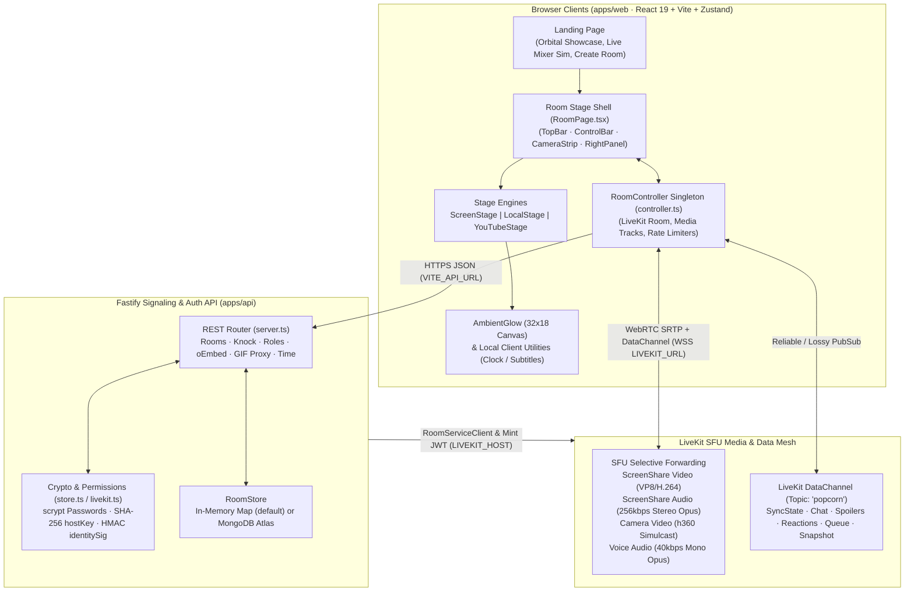
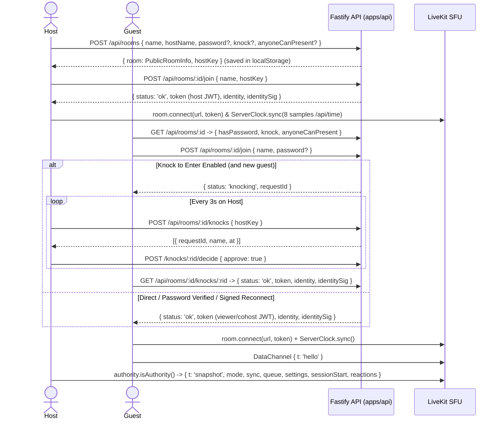

# 🪐 The Orbit (`@popcorn/*`) — Complete Technical Documentation & System Architecture

> **One screen at the center. Everyone in orbit.**
>
> **The Orbit** is a 100% free, zero-account, cinema-grade real-time watch-party platform featuring **Hybrid 4K Local Movie Drop + Live WebRTC Streaming**, **60 fps Low-Latency Screen Share**, **NTP-Synced YouTube Lockstep Playback**, **Real-Time 4-Zone Edge Ambilight**, and **Studio-Isolated Multi-Track Voice & Camera Chat** for desktop and mobile browsers.

---

## Table of Contents

1. [Executive Vision & Core Engineering Rule](#1-executive-vision--core-engineering-rule)
2. [How The Orbit Differs from Every Other Watch-Party App](#2-how-the-orbit-differs-from-every-other-watch-party-app)
3. [High-Level System Architecture & Data Topology](#3-high-level-system-architecture--data-topology)
4. [End-to-End Room Join, Auth, Knock & Sync Sequence](#4-end-to-end-room-join-auth-knock--sync-sequence)
5. [Monorepo Package Structure & Complete File Inventory](#5-monorepo-package-structure--complete-file-inventory)
6. [Media & Real-Time Systems Engineering (Deep Dive)](#6-media--real-time-systems-engineering-deep-dive)
   - [6.1 Dual-Track Audio Isolation, RED Prevention & Bluetooth HFP Guard](#61-dual-track-audio-isolation-red-prevention--bluetooth-hfp-guard)
   - [6.2 Unified Single-Element Hardware A/V Lip-Sync & Playout Lock](#62-unified-single-element-hardware-av-lip-sync--playout-lock)
   - [6.3 Hybrid Local Movie Drop + Live WebRTC Movie Stream](#63-hybrid-local-movie-drop--live-webrtc-movie-stream)
   - [6.4 Low-Latency 60 fps Screen Share Pipeline & Diagnostics](#64-low-latency-60-fps-screen-share-pipeline--diagnostics)
   - [6.5 Client-Side Subtitle Parser & Real-Time Shifter (`.srt` / `.vtt`)](#65-client-side-subtitle-parser--real-time-shifter-srt--vtt)
7. [Time Synchronization & YouTube Lockstep Algorithms](#7-time-synchronization--youtube-lockstep-algorithms)
   - [7.1 NTP Minimum-RTT Clock Offset Estimation (`ServerClock`)](#71-ntp-minimum-rtt-clock-offset-estimation-serverclock)
   - [7.2 YouTube Timeline Math, Drift Matrix & Autoplay Recovery](#72-youtube-timeline-math-drift-matrix--autoplay-recovery)
8. [Visual Immersion, Camera Engineering & Responsive UI](#8-visual-immersion-camera-engineering--responsive-ui)
   - [8.1 Dynamic 4-Zone Canvas Ambilight Engine (`AmbientGlow`)](#81-dynamic-4-zone-canvas-ambilight-engine-ambientglow)
   - [8.2 Six Non-Pink Cinema Themes (`[data-theme]` Specification)](#82-six-non-pink-cinema-themes-data-theme-specification)
   - [8.3 Camera Hardware Lifecycle, Orientation Parity & Mobile Layout](#83-camera-hardware-lifecycle-orientation-parity--mobile-layout)
   - [8.4 Complete UI Component Flows, Chat, Queue, Recap Heatmap & Shortcuts](#84-complete-ui-component-flows-chat-queue-recap-heatmap--shortcuts)
9. [State Management Schema (`useRoom` Zustand Store & Persistence)](#9-state-management-schema-useroom-zustand-store--persistence)
10. [Security Model, Cryptography, Roles & Rate Limiting](#10-security-model-cryptography-roles--rate-limiting)
11. [Complete REST API & LiveKit DataChannel Protocol Schemas](#11-complete-rest-api--livekit-datachannel-protocol-schemas)
12. [Hard-Won Engineering Lessons & Production Bugs Solved](#12-hard-won-engineering-lessons--production-bugs-solved)
13. [Local Development, Testing & Free-Tier Production Deployment](#13-local-development-testing--free-tier-production-deployment)

---

## 1. Executive Vision & Core Engineering Rule

Standard video-conferencing tools optimize for human speech over noisy microphones, while consumer watch-party extensions require logins, desktop executables, or inject compression and audio ducking that ruin film scores.

**The Orbit** is designed around two strict guarantees:

1. **Acoustic Purity:** Movie/screen sound must ride in **unprocessed 48 kHz stereo (256 kbps Opus)** with Acoustic Echo Cancellation (AEC), Noise Suppression (NS), Automatic Gain Control (AGC), Voice Isolation, DTX, and RED redundancy strictly disabled—while friend voices travel on an **independent mono channel (40 kbps Opus)** mixed strictly locally on the receiver.
2. **Zero-Friction Cinema Anywhere:** No account creation, no desktop client installation, and automatic cross-device adaptation from 4K desktops to portrait mobile phones via one shared URL (`/r/:roomId`).

---

## 2. How The Orbit Differs from Every Other Watch-Party App

| Dimension | Teleparty / Browser Extensions | Discord / Meet Screen Share | Hyperbeam / Virtual Browsers | **The Orbit** |
| :--- | :--- | :--- | :--- | :--- |
| **Install / Account** | Requires extension + streaming login | Requires account + desktop app for good audio | Account + paid HD / time queues | **Zero signup, zero install, pure web URL** |
| **Audio Separation** | Relies on external voice app | Often applies voice ducking/NS/mono collapse; Bluetooth HFP breaks music | Server browser encode only | **Strict dual-track WebRTC isolation + auto non-Bluetooth mic picker + stereo restore** |
| **Bluetooth Headset Fix** | Doesn't touch audio devices | Windows/phone switches headset to 8 kHz mono telephony when mic opens | No voice mic isolation | **Filters out `handsfree/hfp/bluetooth` mics automatically & unpublishes hardware track on mute** |
| **Audio/Video Lip-Sync** | Plays audio & video inside external site | Separate WebRTC audio/video consumers drift under packet loss | Server VNC/VM stream | **Unified single `<video>` element attachment + `120 ms` matched `setPlayoutDelay` on both tracks** |
| **Local Movie Files** | Not supported | Must share screen window (captures OS UI, extra GPU load) | Requires uploading gigabytes | **Hybrid:** Drop `.mp4`/`.mkv`/`.webm` locally (0 upload) -> auto-streams live WebRTC `H.264` to phones, OR synced local 4K copies |
| **Custom Subtitles** | Streaming service captions only | None | None | **Client-side `.srt` → WebVTT parser + real-time `±0.5 s` offset shifter + 4 typography sizes** |
| **Ambilight & Themes** | None | Static dark theme | Static frame | **Real-time `32×18` edge-sampling 4-zone Ambilight wall glow + 6 curated cinema themes (incl. True OLED Black)** |
| **Cost** | Paid features / ads | Nitro paywall for 1080p60 | Paid minutes/HD tiers | **100% Free** (Vercel + Render + LiveKit Cloud Free Tier / Oracle Always Free Docker) |

---

## 3. High-Level System Architecture & Data Topology

**The Orbit** cleanly decouples **control/token signaling** (Fastify Node API) from **real-time WebRTC media & peer state** (LiveKit SFU), leaving heavy video/subtitle processing completely on the client:



---

## 4. End-to-End Room Join, Auth, Knock & Sync Sequence

Every room join guarantees host authority integrity, waiting-room gating when enabled, clock synchronization before media drift checks run, and instant state catch-up for latecomers:



### Authority Election (`controller.isAuthority()`)
Because rooms have no persistent game-loop server holding timeline state, the connected participants deterministically elect one authority client using `roleRank`:
$$\text{Rank Order} = \text{roleRank}[\text{host}] (2) > \text{roleRank}[\text{cohost}] (1) > \text{roleRank}[\text{viewer}] (0)$$
Ties break by earliest `joinedAt` timestamp, then lexicographical `identity.localeCompare()`. If the host leaves temporarily, a co-host seamlessly takes over snapshot and buffer-pause duties without interrupting playback.

---

## 5. Monorepo Package Structure & Complete File Inventory

| Workspace / File | Responsibility & Exported Core Symbols |
| :--- | :--- |
| **`packages/shared/src/index.ts`** | Role definitions (`Role`), `ParticipantMeta`, `PublicRoomInfo`, `CreateRoomRequest/Response`, `JoinRequest/Response`, `KnockRequestInfo`, `LIMITS` (`chatMaxLength: 500`, `chatBurst: 6`, `chatWindowMs: 10_000`, `nameMaxLength: 32`, `roomNameMaxLength: 48`), `hueFromString()`, `parseMeta()` |
| **`packages/shared/src/messages.ts`** | `StageMode`, `RoomTheme`, `QueueItem`, `ChatReply`, `ChatGif`, `ReactionMark`, `RoomSettings` (`DEFAULT_SETTINGS`), all 18 `DataMessage` union variants, `DATA_TOPIC = 'popcorn'`, `encodeMessage()`, `decodeMessage()`, `sortQueue()` |
| **`packages/shared/src/sync.ts`** | `SyncState`, `EMPTY_SYNC`, `DRIFT`, `expectedPosition()`, `msUntilStart()`, `decideDrift()`, `computeOffset()`, `formatTime()` |
| **`packages/shared/src/youtube.ts`** | `parseYouTubeId()` (`youtu.be`, `watch?v=`, `/embed/`, `/shorts/`, `/live/`, `/v/`, bare 11-char ID), `parseYouTubeStart()` (`?t=`, `&start=`, `1h2m3s`), `ytThumb()` |
| **`packages/shared/src/sync.test.ts`** | 18 Vitest unit tests validating clock offset math, drift decisions, countdown clamping, YouTube parsing, and queue sorting |
| **`apps/api/src/config.ts`** | Strict production env check (`LIVEKIT_URL`, `LIVEKIT_API_KEY`, `LIVEKIT_API_SECRET`), `CORS_ORIGINS`, `LIVEKIT_HOST` auto-upgrade (`wss->https`), `IDENTITY_SECRET`, `MONGODB_URI`, `GIPHY_API_KEY`, `TOKEN_TTL` |
| **`apps/api/src/store.ts`** | `RoomRecord`, `MemoryStore`, `MongoStore` (`createStore()`), salted `scryptSync` (`hashPassword` / `verifyPassword`), `sha256()`, `safeEqualHex()`, HMAC-SHA256 (`signIdentity` / `verifyIdentity`), `toPublic()` |
| **`apps/api/src/livekit.ts`** | `RoomServiceClient`, `roleFor()`, `canPresent()`, `sourcesFor()`, `mintToken()`, `applyParticipantState()`, `applyToAll()`, `muteMic()` |
| **`apps/api/src/server.ts`** | Fastify server (`trustProxy: true`, `bodyLimit: 64 KB`, `8 MB` octet-stream parser for `/api/speedtest`), all 15 REST endpoints, 10-minute ephemeral knock map reaper, YouTube `oEmbed` in-memory cache |
| **`apps/web/src/room/controller.ts`** | `RoomController` singleton (`controller`), `VOICE_CAPTURE`, `SCREEN_AUDIO_CAPTURE`, WebRTC lifecycle, mic/cam/screen/local-movie publishing, `AnalyserNode` voice monitor, volume & ducking engine, rate limiters, black-frame detector |
| **`apps/web/src/store/room.ts`** | `useRoom` Zustand store, `canControl`, `roleRank`, `LocalMovieState`, `AmbientColors`, `PersonVM`, `ChatMsg`, `ChatToastItem`, `FloatingReaction`, responsive mobile `< 768px` default layout detection |
| **`apps/web/src/lib/clock.ts`** | `ServerClock` singleton (`clock`) polling `/api/time` |
| **`apps/web/src/lib/subtitles.ts`** | `srtToVtt()`, `shiftVtt()`, `createSubtitleTrack()` |
| **`apps/web/src/lib/browser.ts`** | `detectBrowser()` -> `caps` (`chrome`/`edge`/`firefox`/`safari`, OS detection, `canShareScreen`, `canShareAudio`, `canShareSystemAudio`) |
| **`apps/web/src/lib/api.ts`** | Typed fetch client reading `import.meta.env.VITE_API_URL`, `api.uploadMbps()` generating 2 MB pseudo-random payload probe |
| **`apps/web/src/lib/session.ts`** | `session` (`popcorn:room:${id}`, `popcorn:name`), `loadPref()`, `savePref()` (`popcorn:pref:*`) |
| **`apps/web/src/lib/fullscreen.ts`** | `toggleRoomFullscreen()` & `initFullscreenListener()` targeting `#room-stage-root` |
| **`apps/web/src/pages/Landing.tsx`** | Orbital Landing page, interactive Theater Demo (mode & theme switching + heatmap), interactive Dual-Track Mixer simulator with `Smart Duck`, trajectory onboarding steps, and `CreateRoomDialog` |
| **`apps/web/src/pages/RoomPage.tsx`** | Active cinema container, global drag-and-drop overlay for movies & subtitles, room-wide Ambilight wall projection, Dark Glass Pre-Join / Knock / Error / Disconnect gates, global keyboard shortcuts |
| **`apps/web/src/components/*`** | `TopBar`, `ControlBar`, `FullscreenHud`, `RightPanel`, `CameraStrip`, `ScreenStage`, `LocalStage`, `YouTubeStage`, `AmbientGlow`, `ThemeSelector`, `MixerPopover`, `ChatTab`, `PeopleTab`, `QueueTab`, `RoomDialogs`, `ChatToastOverlay`, `ReactionsOverlay`, `Logo`, `YoutubeIcon`, `ui` |
| **`infra/` & `tests/`** | `DEPLOYMENT.md`, `Dockerfile.api`, `docker-compose.yml`, `livekit.yaml`, `tests/playwright.config.ts`, `tests/room.spec.ts` |

---

## 6. Media & Real-Time Systems Engineering (Deep Dive)

### 6.1 Dual-Track Audio Isolation, RED Prevention & Bluetooth HFP Guard

```text
[ Sender Browser ]
  ├── Screen / Movie Audio Track (Track.Source.ScreenShareAudio)
  │     • capture: channelCount=2, sampleRate=48000, AEC=false, NS=false, AGC=false, goog*=false
  │     • publish: audioPreset={maxBitrate: 256_000}, forceStereo=true, dtx=false, red=false
  │
  └── Microphone Voice Track (Track.Source.Microphone)
        • filter: auto-excludes bluetooth / headset / hands-free / hfp / sco / airpods / buds
        • capture: channelCount=1, EC/NS synced to user toggle, AGC=false, voiceIsolation=false
        • publish: audioPreset={maxBitrate: 40_000}, forceStereo=false, dtx=false, red=true
        • re-assert: immediately calls applyConstraints(stereo raw) on active ScreenShareAudio
                                       │
                                       ▼
[ LiveKit SFU -> Receiver Browser (webAudioMix: false) ]
  ├── Voice Elements (#audioHost) ──► Gain = muted[id] ? 0 : friendsVolume * perPerson[id]
  └── Media Video Element         ──► Gain = min(1.0, streamVolume * duck)
                                      (Smart Duck: 40ms step smoothing 1.0 <-> 0.7 [-3 dB])
```

1. **Why `red: false` on Stereo Music Was Critical:** Checking LiveKit's `LocalParticipant.mjs` source revealed that enabling RFC 2198 RED (`red: true`) alongside `forceStereo: true` wraps stereo Opus packets in redundant voice-oriented framing that breaks or cuts out sustained musical frequencies. Explicitly enforcing `red: false` on both `ScreenShareAudio` and `local-movie-audio` preserves clean 256 kbps stereo audio.
2. **Bluetooth Hands-Free Profile (HFP) Protection:** Opening a Bluetooth headset microphone on Windows or mobile switches the OS Bluetooth audio profile from stereo A2DP (48 kHz) into bi-directional telephony HFP (8–16 kHz mono), making movies sound tinny. `controller.toggleMic()` scans enumerated inputs first, prefers built-in/array/wired microphones, removes premature `getUserMedia` probing on popover open, and on Mute/Off explicitly calls `mediaStreamTrack.stop()` + `unpublishTrack(pub.track, true)` so OS audio hardware exits recording mode and snaps back to hi-fi stereo immediately.
3. **Zero-Output Voice Transmission Meter (`startLocalAudioMonitor`):** Creates an isolated `AudioContext` (`sinkId: { type: 'none' }` when supported) reading frequency bins (`fftSize: 128`) every `60 ms`. Speech detection activates above normalized average energy `0.012` with a 4-frame (`240 ms`) trailing hold, powering the live voice equalizer without feeding mic audio back to local speakers.

---

### 6.2 Unified Single-Element Hardware A/V Lip-Sync & Playout Lock

- **Problem Solved:** Previously, `controller.attachAudio()` appended `ScreenShareAudio` tracks to hidden `<audio>` tags in `#audioHost` while `<video>` played muted video. Chromium assigns separate jitter buffers to detached `<audio>` and `<video>` elements, allowing audio to lead lagging video under network fluctuations.
- **Unified Attachment:** `controller.attachAudio()` now routes **only** `Track.Source.Microphone` to `#audioHost`. Both `LocalStage.tsx` and `ScreenStage.tsx` call `vPub.track.attach(videoEl)` and `aPub.track.attach(videoEl)` onto the **single stage `<video>` element**, letting Chrome's hardware media pipeline synchronize both tracks on one shared clock (`Track.attach` appends tracks onto `videoEl.srcObject`).
- **Late-Audio Clock Reset (`LocalStage.tsx`):** If `ScreenShareAudio` subscribes after `ScreenShare` video has already begun playing (`audioArrivedAfterVideo`), `LocalStage` performs a clean one-time detach/re-attach of both tracks together so audio and video initialize synchronously.
- **Jitter Buffer Cap:** On `RoomEvent.TrackSubscribed`, `controller.ts` sets `track.setPlayoutDelay(0.12)` (`120 ms`) uniformly on `ScreenShare` and `ScreenShareAudio`, and `pub.setVideoQuality(VideoQuality.HIGH)` on video so `adaptiveStream` never downgrades mobile portrait viewports to low-resolution layers.

---

### 6.3 Hybrid Local Movie Drop + Live WebRTC Movie Stream

Designed so **one user drops a file and guests/phones immediately watch and hear it**, while still preserving optional uncompressed local-file sync when two desktop peers share the same file:

1. **Host Pipeline (`LocalStage.tsx` + `controller.startLocalMovieStream`)**:
   - Opens `.mp4`, `.mkv`, `.webm`, `.mov`, `.avi`, `.ts`, `.flv`, or `.wmv` via `URL.createObjectURL(file)`.
   - On `onPlaying` (ensuring active audio + video frames exist together), calls `videoEl.captureStream()` (uncapped native frame rate, avoiding 3:2 pull-down judder on 24 fps films; falls back to `mozCaptureStream`).
   - Stops any manual Screen Share first (`stopShare()`), applies raw stereo audio constraints (`AEC=false, NS=false, AGC=false`), computes smart resolution scaling (`scaleDown = videoWidth > 2560 ? ... : 1` / `videoWidth > 1920 ? Math.min(2.5, videoWidth/1920) : 1` so 4K files stream crisp 1080p without choking WebRTC encoders), and publishes **both** video (`H.264`, `7.5 Mbps`, `backupCodec: false`, `maintain-resolution`, `simulcast: false`) and audio (`256 kbps` stereo Opus, `red: false`) **concurrently via `Promise.all`** under shared `stream: 'local-movie'`.
   - Registers an `addtrack` listener on the captured `MediaStream` in case Chromium exposes the audio track milliseconds after `play()` starts.
2. **True `1.0×` Speed Sync Algorithm (`LocalStage.tsx`)**:
   - Playing/resuming local movies uses `leadTime = 0 ms` and `rate = 1` (`controller.play()`).
   - `LocalStage` strictly locks `v.playbackRate = sync.rate || 1` on `loadedmetadata`, `pause`, and `play`—**never applying `1.04×`/`0.96×` rate nudging** (eliminating pitch/tempo speedup after starting or resuming from pause).
   - Waits `1400 ms` (`playTransitionAtRef`) after starting playback for heavy 4K decoders to spin up, schedules `3-2-1` countdown starts precisely via `setTimeout`, and hard-seeks only when drift exceeds `1.5 s`.
3. **Guest Experience**:
   - Automatically subscribes to the host's `local-movie` stream and plays it immediately inside `LocalStage` (`Live from <host>`) with no local file required—with a one-click **Tap to Enable Movie Sound** pill if mobile autoplay policy blocks unmuted playback.
   - Guests holding the exact same file locally can click **Use Local 4K Copy** to switch to uncompressed native playback, or toggle **Back to Live Host Stream** at any time.

---

### 6.4 Low-Latency 60 fps Screen Share Pipeline & Diagnostics

Implemented in `controller.startShare()` and [ScreenStage.tsx](file:///d:/Projects/Popcorn%20Room/apps/web/src/components/ScreenStage.tsx):

- **Encoding Profile**: Single-stream **`videoCodec: 'vp8'`** (`backupCodec: false`, `simulcast: false`, `degradationPreference: 'balanced'`, `contentHint: 'motion'`). Defaults to **`share60 = true` (`1920×1080 @ 60 fps`, `6.0 Mbps`; `30 fps / 4.5 Mbps` toggle in Mixer)**.
- **HiDPI Scale Guard**: Reads `mediaStreamTrack.getSettings().width`; if Windows/macOS DPI scaling captures above `1920px`, automatically applies `scaleResolutionDownBy` on `RTCRtpSender` to keep frame timing locked with audio.
- **Built-In Presenter Diagnostics**:
  - `api.uploadMbps()` probes `POST /api/speedtest` once on first share and triggers `slowUpload` banner if bandwidth `< 8 Mbps` (60 fps) or `< 5 Mbps` (30 fps).
  - Checks `lp.getTrackPublication(Track.Source.ScreenShareAudio)` to warn Chrome/Edge users if **"Also share tab audio"** was forgotten (`noShareAudio`).
  - `startBlackFrameDetector()` samples outgoing frames onto a `32×18` canvas every `2 s`; if max luminance `< 10` for 3 consecutive ticks (`blackFrame`), alerts the host about DRM protection (Netflix/Prime/Disney+).
- **Zero-Loop Stability & GPU Toggle**: `ScreenStage` memoizes `setVideoNode` via `useCallback`, keeps `AmbientGlow` off on the presenter's own self-preview to reserve GPU cycles for screen capture, and includes a **Hide Preview (Save GPU)** / **Show Preview** toggle on the host stage.

---

### 6.5 Client-Side Subtitle Parser & Real-Time Shifter (`.srt` / `.vtt`)

Implemented in [subtitles.ts](file:///d:/Projects/Popcorn%20Room/apps/web/src/lib/subtitles.ts) (100% offline/client-side, zero upload):

- **`srtToVtt()`**: Strips `\uFEFF` UTF-8 BOM, normalizes `\r\n`/`\r` to `\n`, converts SubRip millisecond commas (`HH:MM:SS,mmm`) and shorthand (`MM:SS,mmm`) timestamps into valid `WEBVTT`.
- **`shiftVtt(rawVtt, offsetSec)`**: Parses cue timestamps cleanly and shifts every cue start/end by `±0.5 s` increments, generating a fresh `Blob(['text/vtt'])` URL and revoking the old Blob URL so subtitle timing can be tuned live during playback.
- **Cue Controls**: Toggle `CC` visibility + cycle `sm`, `md`, `lg`, `xl` subtitle CSS styles.

---

## 7. Time Synchronization & YouTube Lockstep Algorithms

### 7.1 NTP Minimum-RTT Clock Offset Estimation (`ServerClock`)

Every client runs `clock.start()` on room connect (`clock.ts` + `sync.ts`):
- Fires `samples = 8` sequential requests (`60 ms` spacing) to uncached `GET /api/time`, recording local send time $t_0$, server timestamp $t_s$, and local receive time $t_1$ (`sync(5)` repeats every `60 s`).
- Computes round-trip time and picks the single lowest-$RTT$ sample to reject asymmetrical network queuing spikes:
  $$\text{RTT} = t_1 - t_0, \qquad \text{offsetMs} = t_s - \left(t_0 + \frac{\text{RTT}}{2}\right)$$
- Normalized room clock anywhere on the client:
  $$\text{clock.now()} = \text{Date.now()} + \text{offsetMs}$$

### 7.2 YouTube Timeline Math, Drift Matrix & Autoplay Recovery

```text
expectedPosition(s, offsetMs, now) =
  (s.status !== 'playing')
    ? s.position
    : s.position + max(0, (now + offsetMs - s.serverTime) / 1000) * s.rate
```

- **Scheduled Countdowns (`msUntilStart`)**: `controller.loadVideo()` adds `+900 ms` lead time (`+3600 ms` on `startCountdown()`) to `serverTime`. While `msUntilStart > 0`, players hold paused at `sync.position` and count down `3-2-1` before starting on the same server instant.
- **Drift Rules (`decideDrift`, unit-tested in `sync.test.ts`)**:
  - `|drift| <= 0.8 s` (`DRIFT.ok`): Restore `1.0×` if nudged; otherwise no-op.
  - `0.8 s < |drift| <= 2.5 s` (`DRIFT.seek`): Rate-nudge (`0.96×` if ahead, `1.04×` if behind) cleanly without jarring jumps (`YouTubeStage` hard-seeks `> 1.8 s` for snappy recovery).
  - `|drift| > 2.5 s`: Immediate `seekTo(expected, true)`.
- **Edge-Case Protections (`YouTubeStage.tsx` & `controller.ts`)**:
  - `YT_ID_RE = /^[a-zA-Z0-9_-]{11}$/` prevents leftover `.mp4` filenames in `sync.videoId` from crashing `YT.Player` on mode switch; `applySync()` overrides stale `version` counters whenever `videoId` changes cleanly from an active controller.
  - Fallback `150 ms` API readiness poller guarantees `YT.Player` initializes even if `onYouTubeIframeAPIReady` raced with mount.
  - Autoplay recovery: if not `PLAYING`/`BUFFERING` after `850 ms`, retries muted + shows **Tap to Unmute YouTube Sound**; if strict mobile Safari/Chrome still blocks playback after another `800 ms`, mounts a centered **Tap to Watch & Unmute YouTube** gesture button.
  - **Auto-Pause on Buffer**: If `settings.autoPauseOnBuffer` is true and any member buffers for `> 3000 ms`, the authority broadcasts pause + `waiting` member names, resuming playback automatically when all clear.

---

## 8. Visual Immersion, Camera Engineering & Responsive UI

### 8.1 Dynamic 4-Zone Canvas Ambilight Engine (`AmbientGlow`)

- Every `85 ms` (`~12 fps`) inside `requestAnimationFrame`, draws active `<video>` onto a `32×18` offscreen canvas (`willReadFrequently: true`) and computes 5 directional edge averages (`top`: rows 0–3, `bottom`: rows 14–17, `left`: cols 0–4, `right`: cols 27–31, `center`: inner box).
- Applies luminance/chroma vividness expansion so dark cinema scenes emit noticeable color halos:
  $$\text{avg} = \frac{R + G + B}{3}, \qquad c_{\text{boost}} = \text{clamp}_{[0, 255]}\!\Big(\text{round}\big((\text{avg} + (c - \text{avg}) \times 1.45) \times 1.15\big)\Big)$$
- Projects `blur-3xl` radial gradients around the stage (`<video>` carries solid `bg-black` so light never washes out black bars or dark scenes) and updates global `ambient` state in `RoomPage` (`fixed inset-0 blur-3xl opacity-85`). Automatically disables in `oled` theme and switches to theme-matched `softFallback` gradients for cross-origin YouTube iframes.

### 8.2 Six Non-Pink Cinema Themes (`[data-theme]` Specification)

| Theme ID | Display Name | Primary BG (`--theme-bg`) | Accent (`--color-coral-500`) | Special Behavior |
| :--- | :--- | :--- | :--- | :--- |
| `midnight` | Midnight Theater | `#070a12` | `#6366f1` (Indigo) | Balanced slate obsidian theater |
| `oled` | True OLED Pitch Black | `#000000` | `#475569` (Slate) | Pure `#000` pixel-off black; disables Ambilight glare |
| `retro` | Retro 80s Drive-in | `#140e08` | `#f59e0b` (Amber) | Warm vintage gold theater ambiance |
| `cyberpunk` | Cyberpunk Azure | `#040814` | `#0ea5e9` (Sky Blue) | Crisp neon obsidian & cyan rim |
| `nordic` | Nordic Woods | `#05110c` | `#10b981` (Emerald) | Deep forest pine & emerald calm |
| `sunset` | Golden Hour Dusk | `#110b18` | `#f97316` (Tangerine) | Twilight dusk violet & amber warmth |

*Controls (`ThemeSelector.tsx`): Controllers broadcast `{ t: 'theme', theme }` room-wide; viewers apply themes locally (`RoomDialogs.tsx` & `ThemeSelector.tsx`).*

### 8.3 Camera Hardware Lifecycle, Orientation Parity & Mobile Layout

- **Hardware Stop & Clean Restart (`controller.toggleCamera`)**: Turning Camera OFF stops `mediaStreamTrack` hardware (turning off LEDs cleanly), calls `unpublishTrack(pub.track, true)`, and invokes `setCameraEnabled(false)` under a `camToggling` re-entrancy mutex. Turning ON clears any stale/ended publications and opens a fresh `h360` simulcast stream, indexing `camTrackId` by `mediaStreamTrack.id` so `CameraTile` attaches new tracks immediately on first toggle.
- **Exact Left-to-Right Orientation Parity (`CameraStrip.tsx`)**: Raw laptop/mobile front webcam feeds arrive horizontally mirrored; `CameraTile` defaults `flipped = true` (`-scale-x-100`) on **both** local and remote tiles so presenters and viewers see identical orientation, with a per-tile hover **Flip (`FlipHorizontal2`)** toggle and **Pin (`Pin`)** spotlight sort (sorting pinned people first, highlighting active speakers with an emerald ring + 3-bar equalizer).
- **Mobile-First Non-Overlapping Layout (`RoomPage.tsx`)**: Forces `flex-col md:flex-row` on the stage wrapper (`min-h-[200px]` stage minimum height), places **Show People (n)** below the video surface instead of floating over corners, defaults mobile viewports (`< 768px`) to `'bottom'` compact camera tiles (`w-28 h-20`), and houses Chat / People / Queue inside a `62dvh` backdrop-dimmed bottom sheet (`RightPanel.tsx`).

### 8.4 Complete UI Component Flows, Chat, Queue, Recap Heatmap & Shortcuts

- **Chat (`ChatTab.tsx` & `ChatToastOverlay.tsx`)**: Consecutive messages grouped within 2 minutes; quote replies (`replyTo`); inline 24-emoji picker; full-frame 2-column masonry **GIPHY** search with 7 quick tags; **Spoiler Guard** (`vt` hides messages posted at later YouTube timestamps with 1-click Reveal); copy button; scroll-to-latest pill; and floating notification toasts when the chat drawer is collapsed.
- **Queue & Ready Check (`QueueTab.tsx`)**: Paste any YouTube link (`parseYouTubeId` / `parseYouTubeStart`), vote items up (`sortQueue` by votes desc -> `addedAt` asc), trigger room-wide **Everyone Ready?** check (`readyCount / people.length`), and launch a `3-2-1` synchronized countdown.
- **Session Reaction Recap (`RoomDialogs.tsx` -> `RecapDialog`)**: Aggregates up to `2,000` recorded `ReactionMark` events across **12 timeline bins** into an interactive peak-activity bar heatmap alongside emoji usage tallies (`😂 ❤️ 🔥 🍿 👏 😱`).
- **Keyboard Shortcuts**:
  - Global Stage: `F` Fullscreen · `T` Theatre Mode · `Esc` Exit Theatre -> Exit Fullscreen -> Collapse Drawer
  - Local Movie Stage: `Space` Play/Pause · `←` / `→` Skip ±10 s · `M` Mute/Unmute
  - Voice Push-to-Talk (when enabled): Hold `Space` to transmit

---

## 9. State Management Schema (`useRoom` Zustand Store & Persistence)

Central client store in [store/room.ts](file:///d:/Projects/Popcorn%20Room/apps/web/src/store/room.ts):

- **Session & Stage State**: `connection` (`'idle' | 'connecting' | 'connected' | 'reconnecting' | 'disconnected'`), `disconnectReason`, `roomInfo`, `me` (`identity`, `identitySig`, `role`, `name`, `hostKey`), `mode` (`StageMode`), `sync` (`SyncState`), `queue` (`QueueItem[]`), `settings` (`RoomSettings`), `sessionStart`, `countdownAt`, `readyCheck`, `waitingFor`, `playhead`, `ytTitle`
- **Participants & Social**: `people` (`PersonVM[]` sorted by `roleRank` then `joinedAt`), `knocks` (`KnockRequestInfo[]`), `chat` (capped at 300 entries), `unread`, `chatToasts` (max 3 stacked), `reactions` (max 2000), `floating` (max 40 animated cheers)
- **Audio & Media**: `audio` (`streamVolume`, `friendsVolume`, `smartDuck`, `pushToTalk`, `share60`, `echoCancellation`, `micDeviceId`), `perPerson`, `localMuted`, `duck`, `local` (`micOn`, `camOn`, `sharing`, `pttHeld`, `hand`, `ready`, `micLevel`), `localMovie` (`file`, `url`, `fileName`, `fileSize`, `duration`, `subtitles`), `ambient` (`AmbientColors | null`)
- **UI & Diagnostics**: `ui` (`panelOpen`, `tab`, `theatre`, `fullscreen`, `pinned`, `cameraLayout`, `theme`, `ambilight`, dialog flags), `warnings` (`blackFrame`, `noShareAudio`, `needsAudioUnlock`, `slowUpload`), `consent`
- **`localStorage` Persistence (`session.ts`)**: `popcorn:room:${id}` (hostKey/identity/password), `popcorn:name` (display name), and `popcorn:pref:${name}` for persisted audio, theme, ambilight, layout, and media consent flags.

---

## 10. Security Model, Cryptography, Roles & Rate Limiting

- **Role Matrix (`packages/shared/src/index.ts`, `apps/api/src/livekit.ts`)**:
  - `host`: Full room settings, password/knock config, role promotion (`cohost`/`viewer`), presenter toggling, global mic mute, remove/ban, playback & theme control.
  - `cohost`: Admit/deny knocks, mute viewer mics, remove non-host/non-cohost viewers, playback & queue control.
  - `viewer` (`+presenter` optional): Chat, react, vote queue; screen/local streaming allowed only if promoted or `anyoneCanPresent: true` (enforced server-side via LiveKit `canPublishSources`).
  - `openControl`: When toggled by host, allows all participants to control YouTube/Local playback & queue order.
- **Cryptographic Guarantees (`store.ts` & `livekit.ts`)**:
  - Room passwords salted with 16 random bytes + hashed via Node `scryptSync(pw, salt, 32)` and verified with `timingSafeEqual`.
  - Host secret (`hostKey` 32-char nanoid) hashed with `sha256` on server (`safeEqualHex` check).
  - Participant identity authenticated via `HMAC-SHA256(IDENTITY_SECRET, "${roomId}:${identity}")` (`verifyIdentity` regex-validated 64-hex).
  - LiveKit JWTs explicitly lock **`canUpdateOwnMetadata: false`**.
- **Rate Limits & Persistence**: Fastify `@fastify/rate-limit` (`240/min` global, `20/min` create room, `30/min` join, `600/min` `/api/time`, `120/min` knock poll, `10/min` `/api/speedtest`, `60/min` GIFs) + client `RateLimiter` sliding windows (`6` chats / `10 s`, `8` reactions / `2 s` send, `16` / `2 s` recv). Rooms default to `MemoryStore` and upgrade automatically to `MongoStore` (`mongodb` driver) when `MONGODB_URI` is provided (falling back cleanly on connection errors).

---

## 11. Complete REST API & LiveKit DataChannel Protocol Schemas

### Fastify REST Endpoints (`apps/api/src/server.ts`)

| Method & Path | Request Payload / Query | Response Shape |
| :--- | :--- | :--- |
| `GET /api/health` | — | `{ ok, store, livekitUrl, gifs }` |
| `GET /api/time` | — (`cache-control: no-store`) | `{ t: number }` |
| `POST /api/speedtest` | Raw `application/octet-stream` (`<= 8 MB`) | `{ received: number, t: number }` |
| `POST /api/rooms` | `{ hostName, name?, password?, knock?, anyoneCanPresent? }` | `{ room: PublicRoomInfo, hostKey }` |
| `GET /api/rooms/:id` | Path param `id` | `PublicRoomInfo` (`404` if missing) |
| `POST /api/rooms/:id/join` | `{ name, password?, hostKey?, identity?, identitySig? }` | `JoinResponse` (`status: 'ok' \| 'knocking'`) |
| `GET /api/rooms/:id/knocks/:rid` | Path params `id`, `rid` | `{ status: 'pending' \| 'denied' } \| JoinOk` |
| `POST /api/rooms/:id/knocks` | Host/CoHost auth body | `KnockRequestInfo[]` |
| `POST /api/rooms/:id/knocks/:rid/decide` | Host/CoHost auth + `{ approve: boolean }` | `{ ok: true }` |
| `PATCH /api/rooms/:id/settings` | Host auth + `{ anyoneCanPresent?, knock?, password? }` | `PublicRoomInfo` (syncs LiveKit grants via `applyToAll`) |
| `PATCH /api/rooms/:id/participants/:identity` | Host auth + `{ role?: 'cohost' \| 'viewer', presenter?: boolean }` | `{ ok: true }` (updates LiveKit metadata & sources) |
| `POST /api/rooms/:id/participants/:identity/mute` | Host/CoHost auth | `{ ok: true }` (server-side `mutePublishedTrack`) |
| `POST /api/rooms/:id/participants/:identity/remove` | Host/CoHost auth + `{ ban?: boolean }` | `{ ok: true }` (removes via `roomService`, optional IP/ID ban) |
| `GET /api/oembed?id=...` | `id` matching `/^[\w-]{11}$/` | `{ title, author }` (cached) |
| `GET /api/gifs?q=...` | Optional search string `q` (`<= 64 chars`) | `ChatGif[]` (via GIPHY API `pg-13`, `limit=24`) |

### LiveKit DataChannel Schema (`DATA_TOPIC = 'popcorn'`, `packages/shared/src/messages.ts`)

| Message Tag `t` | Payload Fields | Purpose |
| :--- | :--- | :--- |
| `hello` | — | Broadcast by newly connected participant to request current state |
| `snapshot` | `mode`, `sync`, `queue`, `settings`, `sessionStart`, `reactions` | Sent directly to joining peer by room authority |
| `sync` | `state: SyncState` | Play/pause/seek/video/version/serverTime update |
| `mode` | `mode: 'idle' \| 'screen' \| 'youtube' \| 'local'` | Switches active stage component across all peers |
| `local-meta` | `fileName`, `fileSize?`, `duration?` | Announces host-loaded local movie metadata |
| `theme` | `theme: RoomTheme` | Syncs host-selected cinema theme across the room |
| `settings` | `settings: RoomSettings` | Syncs `openControl` & `autoPauseOnBuffer` |
| `waiting` | `names: string[]` | Notifies room who is buffering before auto-resume |
| `countdown` | `at: number` | Server-time target for synchronized `3-2-1` countdown |
| `chat` | `id`, `text`, `at`, `replyTo?`, `gif?`, `vt?` | Chat message with optional quote reply, GIF & spoiler timestamp |
| `reaction` | `emoji`, `mark: ReactionMark` | Floating live cheer + heatmap timeline mark |
| `presence` | `hand`, `ready`, `buffering` | Peer hand-raise, ready-check & buffering flags |
| `ready-check` | `active: boolean` | Opens/closes Queue readiness poll |
| `queue-add` | `item: QueueItem` | Adds YouTube track (`oEmbed` enriched) to queue |
| `queue-vote` | `id`, `up: boolean` | Upvotes/unvotes a queued track & re-sorts |
| `queue-remove` | `id` | Removes queued item (uploader or controller) |
| `host-mute` | — | Control signal for host mute events |

---

## 12. Hard-Won Engineering Lessons & Production Bugs Solved

Real production bugs uncovered and resolved across desktop/mobile testing in this codebase:

1. **Opus RED (`red: true`) Distorting Stereo Music**: LiveKit SDK requires RED disabled on stereo tracks; disabling `red: false` on `ScreenShareAudio` & `local-movie-audio` stopped music dropouts and metallic distortion.
2. **Multi-Codec Simulcast Bandwidth Doubling (`32 Mbps`)**: `BackupCodecPolicy.SIMULCAST` uploaded primary and backup video streams concurrently, choking Wi-Fi/CPU. Switching to single-stream encoding (`VP8` for Screen Share, `H.264` single stream for Local Movie) eliminated bufferbloat lag.
3. **Inline React Ref Callback Blinking Loop (`ScreenStage`)**: An un-memoized `ref={setVideoNode}` inside a component depending on `videoElState` caused React to detach and re-attach the `<video>` stream on every render; memoizing `setVideoNode` with `useCallback` stabilized playback completely.
4. **Local Movie Pitch/Speed-Up (`1.04×`) on Play/Resume**: A `+50 ms` lead time delayed `tick()` for a full `1500 ms` interval, triggering `decideDrift()`'s `1.04×` speedup for ~20 s. Locking `leadTime = 0 ms`, disabling rate nudging on local files, and adding a `1400 ms` grace period fixed playback speed to exact `1.0×`.
5. **YouTube Blank Screen on Guests**: Passing stale `.mp4` filenames or `undefined` to `YT.Player`, missing `videoId` switch bypass in `applySync`, and strict mobile autoplay blocks left guests on blank iframes—fixed via strict 11-char ID gating, reload-safe `applySync`, and an explicit tap-to-watch/unmute overlay.
6. **Camera Off/On Stuck State & Mirror Orientation**: Replacing LiveKit's `mute()`/`unmute()` (`restartTrack()`) with explicit track `stop()` + `unpublishTrack()` resolved stuck webcam toggles; unifying `flipped = true` (`-scale-x-100`) on both local and remote tiles matched orientation identically on desktop and phone.

---

## 13. Local Development, Testing & Free-Tier Production Deployment

### Prerequisites & Local Setup
- **Node.js v20+** and **npm**

```bash
git clone https://github.com/BhanuNama/Popcorn-Room.git
cd "Popcorn Room"
npm install
cp apps/api/.env.example apps/api/.env
npm run dev                  # Starts Vite (:5173, proxies /api) + Fastify API (:8787)
```
*(Set your free LiveKit Cloud credentials in `apps/api/.env`, or start local LiveKit with `npm run livekit`.)*

### Workspace Scripts & Automated Verification
```bash
npm run typecheck            # Typechecks @popcorn/api, @popcorn/web, and @popcorn/shared
npm test                     # Runs 18 Vitest unit tests in packages/shared/src/sync.test.ts
npm run build                # Builds Vite production bundle (apps/web/dist) + typechecks API
npm run test:e2e             # Runs Playwright suite (tests/room.spec.ts)
```

### Free-Tier Production Stack & Environment Variables

| Component | Recommended Free Host | Required Configuration |
| :--- | :--- | :--- |
| **Frontend** (`apps/web`) | **Vercel** (`https://the-orbit-room.vercel.app`) | Build: `npm run build`, Output: `dist` (SPA fallback in `vercel.json`)<br>Env: `VITE_API_URL=https://popcorn-room.onrender.com` *(no trailing `/`)* |
| **API** (`apps/api`) | **Render** (`https://popcorn-room.onrender.com`) | Start: `npm run start -w @popcorn/api`<br>Env: `NODE_ENV=production`, `LIVEKIT_URL`, `LIVEKIT_API_KEY`, `LIVEKIT_API_SECRET`, `IDENTITY_SECRET`, `CORS_ORIGINS=https://the-orbit-room.vercel.app` *(exact origin, comma-separated if multiple, no trailing `/`)*<br>Optional: `MONGODB_URI`, `GIPHY_API_KEY` |
| **WebRTC SFU** | **LiveKit Cloud** or **Oracle Cloud VM** | [cloud.livekit.io](https://cloud.livekit.io) (`50 GB/mo` free) or self-hosted via [`infra/docker-compose.yml`](infra/docker-compose.yml) (see [`infra/DEPLOYMENT.md`](infra/DEPLOYMENT.md)) |

---

## Privacy & Security Notice

Media streams, camera feeds, subtitles, and voice tracks are transmitted directly over encrypted WebRTC (`DTLS/SRTP`) without server-side media recording or file persistence. Built for private watch parties among friends.
